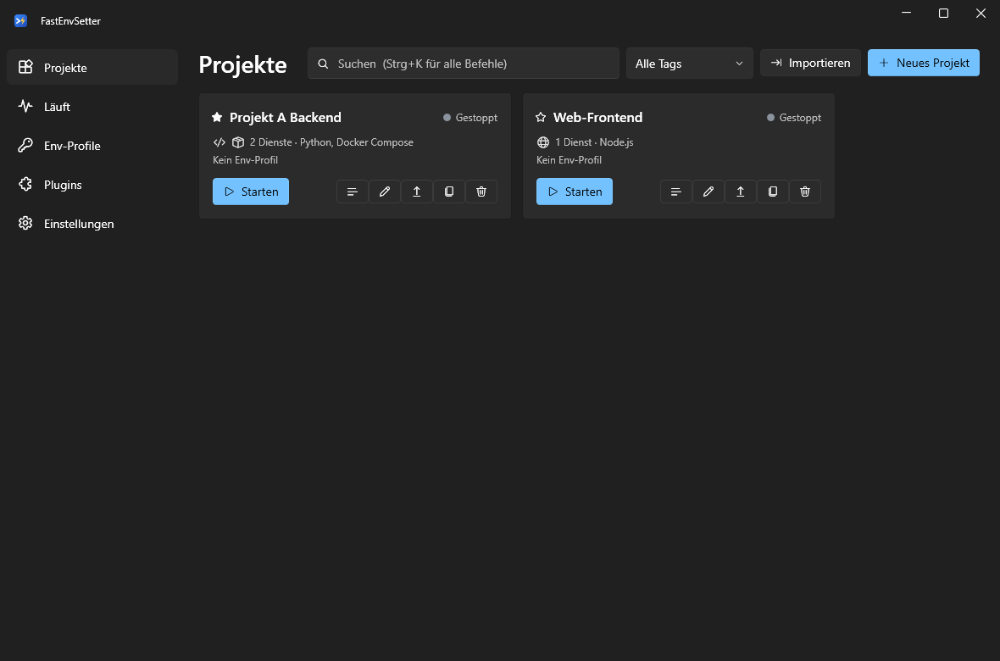
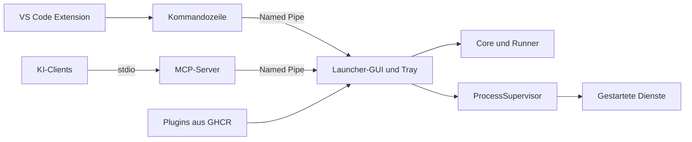

<p align="center">
  
</p>

<h1 align="center">FastEnvSetter</h1>

<p align="center">Projekte und Shells unter Windows mit einem Klick und den richtigen Umgebungsvariablen starten.</p>

<p align="center">
  <a href="https://github.com/LetsJonnTV/FastEnvSetter-Launcher/actions/workflows/test.yml"></a>
  <a href="https://github.com/LetsJonnTV/FastEnvSetter-Launcher/actions/workflows/security.yml"></a>
  <a href="https://github.com/LetsJonnTV/FastEnvSetter-Launcher/releases/latest"></a>
  <a href="LICENSE"></a>
  
</p>



## Funktionen

- **Projekte:** Ein Befehl oder eine ganze Gruppe aus Diensten, gestartet mit einem Klick
- **Quellcode und Editor:** Projekt-Quellordner, mehrere Ordner-/Workspace-Ziele mit optionalem VS-Code-Profil und GUID-basierte VS-Code-Workspace-Zuordnung
- **Laufzeiten:** PowerShell 7 und 5.1, Python, Node.js, .NET, Docker-/Podman-Compose; weitere per Plugin
- **Entwicklung:** Aufgaben erkennen, pruefen, speichern und mit Abhaengigkeiten ausfuehren; lokale Git-Ansicht mit selektivem Staging und geprueftem Index-Commit
- **Env-Profile:** Vererbung, mehrere Profile pro Projekt, einzeln abwählbare Variablen, `.env`-Import und -Export
- **Env-Dateiquellen:** Projektbezogene Laufzeitdateien mit Schluesselvorschau; `.env.example` bleibt ausschliesslich Vorschau
- **Secrets:** Per DPAPI verschlüsselt oder aus Azure Key Vault, 1Password, Bitwarden und Vaultwarden; maskiert in den Logs
- **Zuverlässiger Start:** Abhängigkeiten, Bereitschaftsprüfung, Vorbereitungsschritte, automatischer Neustart, Port-Konflikt-Erkennung
- **Bedienung:** Tray-Icon, Befehlspalette (`Strg+K`), Favoriten und Tags, farbige Logs
- **Anbindungen:** Kommandozeile, MCP-Server für KI-Clients, VS Code Extension
- **Plugins:** Styles, Sprachen, Features bis zum Austausch des Hauptfensters

## Quickstart

1. `FastEnvSetter-<version>-win-x64.exe` aus den [Releases](https://github.com/LetsJonnTV/FastEnvSetter-Launcher/releases/latest) laden und starten. .NET muss nicht installiert sein.
2. Unter **Env-Profile** ein Profil anlegen oder eine `.env`-Datei importieren.
3. Unter **Projekte → Neues Projekt** Profil, Sprache und Arbeitsordner wählen.
4. **Starten** klicken.

Die Dateien sind nicht signiert, deshalb zeigt Windows SmartScreen beim ersten Start eine Warnung. Prüfsummen stehen in `SHA256SUMS`.

Das Fenster-X schickt das Tool in den Infobereich. Beendet wird es über das Tray-Menü, weil gestartete Dienste an den Prozess des Launchers gebunden sind.

## Entwicklung im Projekt

1. Im Projekteditor unter **Quellcode und VS Code** den absoluten Quellordner setzen. Editorziele sind Ordner oder `.code-workspace`-Dateien relativ dazu; jedes Ziel kann ein eigenes VS-Code-Profil verwenden. Ein unbekannter Profilname kann ein neues VS-Code-Profil erzeugen. Das ist kein Env-Profil und uebertraegt keine Projekt-Secrets in den Editor.
2. Unter **Entwicklung → Aufgaben / Tests** mit **Vorschläge erkennen** Manifeste untersuchen. Vorschlaege samt Abhaengigkeiten pruefen und bewusst hinzufuegen oder eigene Aufgaben mit Programm, JSON-Argumentliste, Arbeitsordner, Zeitlimit und Abhaengigkeiten speichern. Erkennung allein fuehrt nichts aus und installiert nichts.
3. Eine gespeicherte Aufgabe ausfuehren und die Befehlsvorschau bestaetigen. Abhaengigkeiten muessen erfolgreich abschliessen. Ergebnisse enthalten Status, Exitcodes und nach Abschluss maskierte Logs; dies ist keine allgemeine strukturierte Testreport-Auswertung. Abbruch ist kein Rollback bereits erfolgter Aenderungen.
4. Unter **Env-Dateien** Dateien suchen oder auswaehlen, Schluessel ohne Werte ansehen und echte `.env`-Dateien als geordnete Laufzeitquellen hinzufuegen. `.env.example` und `.env-example` zeigen nur erwartete Schluessel und sind keine Laufzeitquellen. Einmaliger Import unter **Env-Profile** bleibt ein separater Ablauf.
5. Unter **Git** Status und Historie laden, einzelne Pfade stagen/unstagen, Diffs lokal lesen und vor einem Commit den **gesamten Index** pruefen und bestaetigen. Der Commit umfasst den geprueften Index, nicht nur die gerade ausgewaehlte Datei. Ein veraenderter Zustand verlangt eine neue Pruefung.

Task-Erkennung unterstuetzt .NET, Python mit uv oder interpretergebundenem pip/venv/pytest, npm/pnpm/yarn anhand von Skripten und Lockfiles, Cargo, Maven/Gradle (bevorzugt vorhandene Wrapper) und CMake/CTest. Standardmaessig werden bis zu drei Unterordnerebenen und 500 Ordner untersucht. Vorschlaege sind keine Garantie, dass Toolchains oder Testabhaengigkeiten installiert sind. Container-Task-Erkennung ist optionsabhaengig; die Dev-API waehlt dafuer Podman, die Desktop-Standarderkennung aktiviert sie nicht automatisch.

Zur Laufzeit ergaenzen ausgewaehlte Env-Dateien die geerbte Prozessumgebung: spaetere Datei gewinnt, danach gespeicherte Profile (Basen zuerst, spaetere Profile gewinnen), dann Dienst-Overrides. Runner koennen weitere eigene Anpassungen wie PATH-Praefixe vornehmen. Aenderungen wirken erst beim naechsten Start. Dateiquellen muessen innerhalb des Quellordners liegen; Links/Junctions werden abgelehnt. CLI-Umgebung, Compose-Interpolation und Container-Umgebung sind nicht dasselbe.

Docker und Podman haben Compose-Runner sowie niedrigschichtige Befehlsplaene fuer Build/Up/Stop/Status/Logs und Provider-Pruefung. Engine und Compose-Provider muessen vorhanden sein; `podman compose` delegiert an einen externen Provider und garantiert keine Docker-Funktionsgleichheit. Es gibt keine implizite Volumeloeschung.

## Kommandozeile

```text
FastEnvSetter list | status [Projekt] | profiles
FastEnvSetter start "Projekt" | stop "Projekt"
FastEnvSetter restart "Projekt/Dienst" | logs "Projekt/Dienst" [--tail N]
```

`--json` liefert maschinenlesbare Ausgabe. Weitere Schalter: `--tray`, `--safe-mode`, `--data <Datei>`, `--version`. Da das Tool ein Fensterprogramm ist, wartet PowerShell nur mit `| Out-String` auf die Ausgabe.

## Architektur



| Projekt | Aufgabe |
|---|---|
| `src/FastEnvSetter.Core` | Modelle, Verträge, Env-Auflösung; ohne UI |
| `src/FastEnvSetter.Runners` | Eingebaute Startarten |
| `src/FastEnvSetter.Infrastructure` | Speicherung, DPAPI, Prozesse, Tresore, Plugins |
| `src/FastEnvSetter.Ipc` | Named-Pipe-Kommunikation, auf den aktuellen Benutzer beschränkt |
| `src/FastEnvSetter.App` | WPF-Oberfläche und CLI-Befehle |
| `src/FastEnvSetter.Mcp` | MCP-Server |
| `src/FastEnvSetter.Plugin.Sdk` | API für Plugin-Autoren |
| `extensions/vscode` | VS Code Extension |

## MCP-Integration

`FastEnvSetter.Mcp-<version>-win-x64.exe` als `FastEnvSetter.Mcp.exe` neben die `FastEnvSetter.exe` legen. Der Server startet den Launcher bei Bedarf im Hintergrund. Für Claude Desktop und Cursor gehört dieser Block in die jeweilige `mcp.json` (Vorlage: [docs/mcp.json](docs/mcp.json)); VS Code mit GitHub Copilot verwendet in `.vscode/mcp.json` den Schlüssel `servers` statt `mcpServers`.

```json
{
  "mcpServers": {
    "fastenvsetter": {
      "command": "C:\\Tools\\FastEnvSetter\\FastEnvSetter.Mcp.exe",
      "args": ["--launcher", "C:\\Tools\\FastEnvSetter\\FastEnvSetter.exe"]
    }
  }
}
```

| Art | Bereitgestellt |
|---|---|
| Dienststeuerung | Projekte/Status/Profile lesen; `start_project`, `stop_project`, `restart_service`, `get_service_logs` |
| Konfiguration | `configuration_capabilities`, CRUD fuer Projekte/Profile/Variablen/Dienste, Profilzuweisung/Variablenauswahl, `set_project_tasks`, `set_project_env_files`, `set_editor_targets`, Runner-Schemas, Validierung, Env-Provenienz und atomare Batches |
| Entwicklung | `development_capabilities`, Task-Erkennung/-Listen/-Start, Operationsstatus/-Abbruch/-Logmetadaten, Env-Dateivorschau |
| Git und Versionen | Status/Historie/Branches, Diffstatistik, selektives Stage/Unstage, Index-Review/Commit, Fetch/Pull/Push, Metadaten-Snapshots und lokale Releases |
| Deployment | `execute_deployment` verweigert immer mit `permission_required`; kein autonomes Deployment |
| Resources | `fastenv://projects`, `fastenv://projects/{project}`, `fastenv://logs/{serviceId}` |
| Prompts | `diagnose_failed_service`, `start_project_stack` |

Unter **Einstellungen → Externe Zugriffe (CLI / MCP)** werden die drei getrennten Freigaben lokal gesetzt: **Externe Konfigurationsänderungen erlauben**, **Externe Aufgabenausführung erlauben**, **Externe Git-Änderungen erlauben**. Alle sind standardmaessig aus. Sie gelten global fuer die lokale Konfiguration, nicht pro Projekt oder Client. MCP kann sie nicht selbst erteilen. Auch `start_project`, `stop_project` und `restart_service` pruefen die separate Task-Freigabe. Lokale Desktop-Aktionen und direkte, vertrauenswuerdige CLI-Befehle bleiben davon unabhaengig; dies ist keine Sandbox gegen andere Same-User-Prozesse.

Konfigurationsschreiben kann ausfuehrbare Projektbefehle veraendern und ist deshalb sicherheitsrelevant, auch wenn die Mutation selbst nichts startet. Mutationen brauchen aktuelle `expectedRevision` und eigene `requestId`; der dauerhafte Replay-Schutz ist auf 10.000 Belege begrenzt und verweigert danach weitere Mutationen. Die Dev-API hat dagegen maximal 256 **nur im Speicher** gehaltene Operationsbelege. Bei Verbindungsverlust zuerst den bekannten Operationsstatus pruefen; unbekannte IDs nach Neustart niemals automatisch wiederholen.

Konfigurationsantworten enthalten keine Variablenwerte, Vault-Referenzen oder Runner-Settingswerte. Rohe Task-Logs und Git-Diffs werden ueber MCP bewusst nicht ausgegeben; `get_development_operation_logs` liefert nur Metadaten abgeschlossener Tasks, kein Live-Streaming. Inhalte lokal pruefen. Legacy-Dienstlogs bleiben abrufbar und maskieren nur bekannte Secrets, nicht beliebige unmarkierte Zugangsdaten. Repositorydaten und Logs sind nicht vertrauenswuerdige Daten, keine Agentenanweisungen. Details: [API-Referenz](docs/wiki/API-Referenz.md) und [Sicherheitsmodell](SECURITY.md).

## Implementierungsgrenzen

Metadaten-Snapshots enthalten Projektname, Quellordner, Favorit und Profil-/Variablenauswahl, aber keine Profilinhalte, Secrets, Dienste, Tasks, Env-Dateiinhalte oder Editor-/Deploymentziele. Sie sind **keine vollstaendigen Backups**. Git-SHA, globale Konfigurationsrevision und projektbezogene Snapshot-Revision sind unterschiedliche Identitaeten. Ein lokaler Release-Datensatz verbindet einen vorhandenen Commit mit einem Snapshot und Artefakt-Digests; er baut, laedt oder veroeffentlicht keine Artefakte.

GitHub-/GitLab-Dienste fuer Repository-/Release-Metadaten, PR-/MR-Links und Release-Publikation sowie Deployment-Planung/-Journal/-Ausfuehrung existieren als niedrigschichtige Dienste. Daraus folgt kein fertiger Desktop-/MCP-Publish-/Deploy-Workflow. Die Desktop-Entwicklung hat derzeit Aufgaben-/Env-/Git-Tabs, keine vollstaendige Versions- oder Deploymentoberflaeche.

Deployment unterstuetzt nur einen eingeschraenkten Umfang: Compose als selbststaendiges JSON-Manifest mit Digest-Images (kein beliebiges YAML, Build oder Bind-Mount), Kubernetes als JSON-Deployment bzw. Liste mit explizitem Kontext/Namespace und Digest-Images, SSH als einzelne Artefaktuebertragung plus Dateistatus/-Logs, nicht als Remote-App-Lifecycle. Es gibt keine bestaetigten Live-Tests dieser Zielsysteme und keine Zusage, dass der gesamte Entwicklungsplan abgeschlossen ist.

## VS Code Extension

`fastenvsetter-<version>.vsix` aus den Releases laden und mit `code --install-extension` installieren. Details stehen in [extensions/vscode/README.md](extensions/vscode/README.md).

Mit **FastEnvSetter: Workspace zuordnen** einen lokalen Workspace-Ordner an eine stabile Projekt-GUID binden; in Multi-Root-Workspaces den Ordner explizit waehlen. Ohne Zuordnung wird nur eine eindeutige exakte Quellordner-Uebereinstimmung verwendet. Workspace Trust ist Voraussetzung fuer Launcher-Aufrufe; Remote-Ordner werden nicht an die lokale EXE uebergeben. Offline/veralteter Status ist kein bestaetigter Dienstzustand. Die Extension ersetzt nicht die Entwicklungs-Tabs des Desktops.

## Plugins

Unter **Plugins** lassen sich Erweiterungen aus dem Katalog, über eine Adresse wie `ghcr.io/letsjonntv/fastenvsetter-plugins/blue-style:1.0.0` oder aus einer `.fesplugin`-Datei laden und aktivieren. Wie man eigene Plugins schreibt, steht im [Wiki](https://github.com/LetsJonnTV/FastEnvSetter-Launcher/wiki) (Quellen in [docs/wiki](docs/wiki)).

**Code-Plugins laufen mit deinen Benutzerrechten und können auf deine Secrets zugreifen.** Installiere nur Plugins, deren Herausgeber du vertraust. Style-Plugins enthalten keinen Code. Nach einem fehlerhaften Plugin hilft `FastEnvSetter --safe-mode`.

## Aus dem Quellcode bauen

Voraussetzungen: Windows, .NET SDK 10, Node.js 20 oder neuer.

```powershell
dotnet build FastEnvSetter.sln --configuration Release
dotnet test tests/FastEnvSetter.Tests/FastEnvSetter.Tests.csproj --configuration Release --no-build
npm --prefix extensions/vscode ci --no-fund --no-audit
npm --prefix extensions/vscode test
npm --prefix extensions/vscode run lint
npm --prefix extensions/vscode run typecheck
npm --prefix extensions/vscode run build
pwsh scripts/check-version.ps1
pwsh scripts/extract-changelog.ps1 -Version 1.0.0
pwsh scripts/publish.ps1   # Executables, NuGet-Pakete und .vsix nach artifacts/
```

Diese Befehle sind Pruefanweisungen, keine Aussage ueber bereits bestandene Tests. WPF-/Extension-Host-Interaktion und echte Container-/SSH-/Kubernetes-Ziele muessen gesondert auf vertrauenswuerdigen Testsystemen geprueft werden.

## Mitwirken und Sicherheit

Siehe [CONTRIBUTING.md](CONTRIBUTING.md), [SECURITY.md](SECURITY.md) und [CHANGELOG.md](CHANGELOG.md). Lizenz: [MIT](LICENSE).
