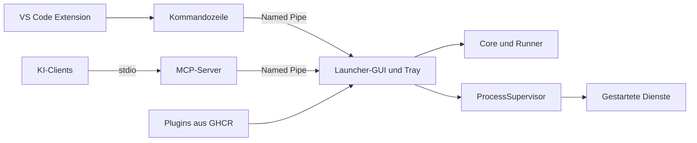

<p align="center">
  
</p>

<h1 align="center">FastEnvSetter</h1>

<p align="center">Projekte und Shells unter Windows mit einem Klick und den richtigen Umgebungsvariablen starten.</p>

<p align="center">
  <a href="https://github.com/LetsJonnTV/FastEnvSetter-Launcher/actions/workflows/test.yml"></a>
  <a href="https://github.com/LetsJonnTV/FastEnvSetter-Launcher/actions/workflows/security.yml"></a>
  <a href="https://github.com/LetsJonnTV/FastEnvSetter-Launcher/releases/latest"></a>
  <a href="LICENSE"></a>
  
</p>


## Funktionen

- **Projekte:** Ein Befehl oder eine ganze Gruppe aus Diensten, gestartet mit einem Klick
- **Laufzeiten:** PowerShell 7 und 5.1, Python, Node.js, .NET, Docker Compose; weitere per Plugin
- **Env-Profile:** Vererbung, mehrere Profile pro Projekt, einzeln abwählbare Variablen, `.env`-Import und -Export
- **Secrets:** Per DPAPI verschlüsselt oder aus Azure Key Vault, 1Password, Bitwarden und Vaultwarden; maskiert in den Logs
- **Zuverlässiger Start:** Abhängigkeiten, Bereitschaftsprüfung, Vorbereitungsschritte, automatischer Neustart, Port-Konflikt-Erkennung
- **Bedienung:** Tray-Icon, Befehlspalette (`Strg+K`), Favoriten und Tags, farbige Logs
- **Anbindungen:** Kommandozeile, MCP-Server für KI-Clients, VS Code Extension
- **Plugins:** Styles, Sprachen, Features bis zum Austausch des Hauptfensters

## Quickstart

1. `FastEnvSetter-<version>-win-x64.exe` aus den [Releases](https://github.com/LetsJonnTV/FastEnvSetter-Launcher/releases/latest) laden und starten. .NET muss nicht installiert sein.
2. Unter **Env-Profile** ein Profil anlegen oder eine `.env`-Datei importieren.
3. Unter **Projekte → Neues Projekt** Profil, Sprache und Arbeitsordner wählen.
4. **Starten** klicken.

Die Dateien sind nicht signiert, deshalb zeigt Windows SmartScreen beim ersten Start eine Warnung. Prüfsummen stehen in `SHA256SUMS`.

Das Fenster-X schickt das Tool in den Infobereich. Beendet wird es über das Tray-Menü, weil gestartete Dienste an den Prozess des Launchers gebunden sind.

## Kommandozeile

```text
FastEnvSetter list | status [Projekt] | profiles
FastEnvSetter start "Projekt" | stop "Projekt"
FastEnvSetter restart "Projekt/Dienst" | logs "Projekt/Dienst" [--tail N]
```

`--json` liefert maschinenlesbare Ausgabe. Weitere Schalter: `--tray`, `--safe-mode`, `--data <Datei>`, `--version`. Da das Tool ein Fensterprogramm ist, wartet PowerShell nur mit `| Out-String` auf die Ausgabe.

## Architektur



| Projekt | Aufgabe |
|---|---|
| `src/FastEnvSetter.Core` | Modelle, Verträge, Env-Auflösung; ohne UI |
| `src/FastEnvSetter.Runners` | Eingebaute Startarten |
| `src/FastEnvSetter.Infrastructure` | Speicherung, DPAPI, Prozesse, Tresore, Plugins |
| `src/FastEnvSetter.Ipc` | Named-Pipe-Kommunikation, auf den aktuellen Benutzer beschränkt |
| `src/FastEnvSetter.App` | WPF-Oberfläche und CLI-Befehle |
| `src/FastEnvSetter.Mcp` | MCP-Server |
| `src/FastEnvSetter.Plugin.Sdk` | API für Plugin-Autoren |
| `extensions/vscode` | VS Code Extension |

## MCP-Integration

`FastEnvSetter.Mcp-<version>-win-x64.exe` als `FastEnvSetter.Mcp.exe` neben die `FastEnvSetter.exe` legen. Der Server startet den Launcher bei Bedarf im Hintergrund. Für Claude Desktop und Cursor gehört dieser Block in die jeweilige `mcp.json` (Vorlage: [docs/mcp.json](docs/mcp.json)); VS Code mit GitHub Copilot verwendet in `.vscode/mcp.json` den Schlüssel `servers` statt `mcpServers`.

```json
{
  "mcpServers": {
    "fastenvsetter": {
      "command": "C:\\Tools\\FastEnvSetter\\FastEnvSetter.Mcp.exe",
      "args": ["--launcher", "C:\\Tools\\FastEnvSetter\\FastEnvSetter.exe"]
    }
  }
}
```

| Art | Bereitgestellt |
|---|---|
| Tools | `list_projects`, `get_project_status`, `start_project`, `stop_project`, `restart_service`, `get_service_logs`, `list_env_profiles` |
| Resources | `fastenv://projects`, `fastenv://projects/{project}`, `fastenv://logs/{serviceId}` |
| Prompts | `diagnose_failed_service`, `start_project_stack` |

Der Server gibt nie Variablenwerte aus, Logs nur maskiert. Es gibt bewusst keine Tools zum Ändern von Befehlen. Ein KI-Client kann aber konfigurierte Projekte starten und stoppen.

## VS Code Extension

`fastenvsetter-<version>.vsix` aus den Releases laden und mit `code --install-extension` installieren. Details stehen in [extensions/vscode/README.md](extensions/vscode/README.md).

## Plugins

Unter **Plugins** lassen sich Erweiterungen aus dem Katalog, über eine Adresse wie `ghcr.io/letsjonntv/fastenvsetter-plugins/blue-style:1.0.0` oder aus einer `.fesplugin`-Datei laden und aktivieren. Wie man eigene Plugins schreibt, steht im [Wiki](https://github.com/LetsJonnTV/FastEnvSetter-Launcher/wiki) (Quellen in [docs/wiki](docs/wiki)).

**Code-Plugins laufen mit deinen Benutzerrechten und können auf deine Secrets zugreifen.** Installiere nur Plugins, deren Herausgeber du vertraust. Style-Plugins enthalten keinen Code. Nach einem fehlerhaften Plugin hilft `FastEnvSetter --safe-mode`.

## Aus dem Quellcode bauen

Voraussetzungen: Windows, .NET SDK 10, Node.js 20 oder neuer.

```powershell
dotnet test
pwsh scripts/publish.ps1   # Executables, NuGet-Pakete und .vsix nach artifacts/
```

## Mitwirken und Sicherheit

Siehe [CONTRIBUTING.md](CONTRIBUTING.md), [SECURITY.md](SECURITY.md) und [CHANGELOG.md](CHANGELOG.md). Lizenz: [MIT](LICENSE).
